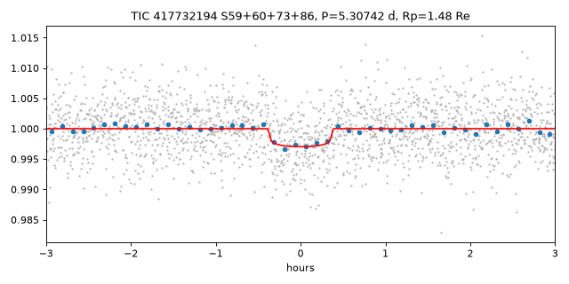
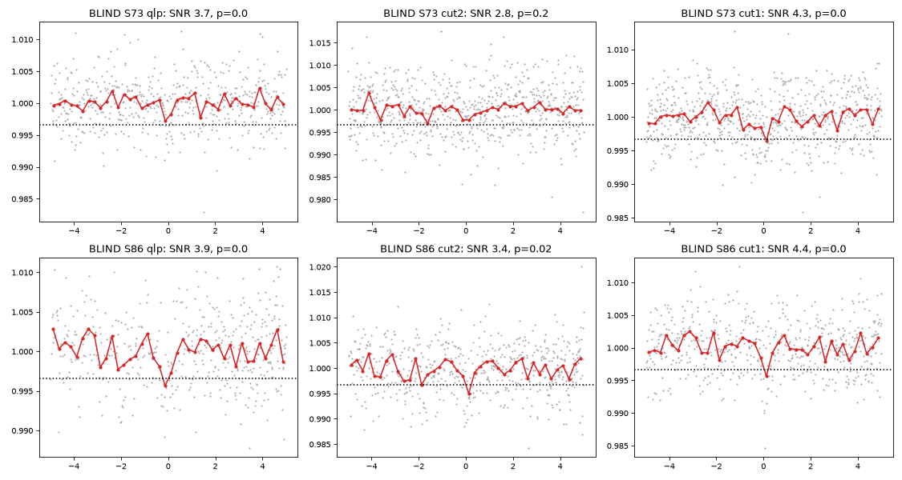

# G 249-11 b? A 1.6 R⊕ transiting planet candidate (unconfirmed)

> **Status: unconfirmed planet candidate.** After accounting for selection, the evidence is about **3σ**. Two false
> positives remain viable: a bound eclipsing companion, and a G = 17.2 star 20″ away. This is not a confirmed planet
> and has not been refereed.

Infinity Machine was run in open-ended discovery mode on TESS photometry of 7,474 M dwarfs within 40 pc. It surfaced
one candidate around the nearby M4.5 dwarf **G 249-11 (TIC 417732194)**.

Preprint (Research Note of the AAS format): [`G249-11_note.pdf`](G249-11_note.pdf).
Full deposit: [doi:10.5281/zenodo.23651676](https://doi.org/10.5281/zenodo.23651676) (concept DOI, latest version).

## Target and ephemeris

| | |
|---|---|
| Star | G 249-11 = TIC 417732194 = Gaia DR3 484671464331349632, M4.5V, 29.1 pc, Tmag 12.30 |
| Position | RA 05:30:40.9, Dec +68:54:04 (J2016) |
| Period | P = 5.307425 ± 0.000008 d |
| Epoch | T0 = 2459912.3151 ± 0.0008 BJD_TDB |
| Depth / duration | 3.0 ± 0.4 ppt, T14 = 0.88 ± 0.04 h, b = 0.83 ± 0.03 |
| Radius / temperature | Rp = 1.61 ± 0.09 R⊕, Teq ≈ 410 K |

Predicted mid-transits are `T(N) = 2459912.3151 + 5.307425·N`. Observing windows for late 2026 to 2027, with site
altitude and Moon, are in [`followup/transit_windows.csv`](followup/transit_windows.csv). Plan at least ±30 min around
each prediction.

## Evidence

* **Detection.** A BLS search of TESS-SPOC FFI light curves flagged the signal. The discovery data are SPOC 2-min
  Sectors 19, 59 and 60.
* **Blind predictions.** An ephemeris fitted to Sectors 59–60 predicted dips in QLP Sectors 73 and 86. Those sectors
  were never used for selection, and the predicted dips appear in both.
* **Null test.** In 400 full-pipeline nulls (transits masked, sectors circularly shifted), chance matches had
  p = 0.09 (S73) and 0.0025 (S86), about 0.002 combined.
* **Vetting:**
  * odd and even depths agree (1.2σ);
  * there is no secondary eclipse;
  * the depth is stable across detrendings;
  * the residuals are white;
  * the TESScut difference image centres on or next to the target pixel.

## What would confirm or reject it

* Ground-based photometry of a predicted transit, which would rule the 20″ neighbour in or out.
* Radial velocities, to rule out a bound eclipsing companion and measure a mass.
* High-resolution imaging.

## Files

| path | content |
|---|---|
| `G249-11_note.pdf` | the note |
| `vetting/REPORT.md` | full vetting record, including the corrections made after an independent adversarial review |
| `vetting/fit2.json` | transit-fit posteriors, with and without the stellar-density prior |
| `vetting/stress.json` | the 400 full-pipeline null realisations |
| `vetting/star_clean.json` | stellar parameters (TIC, Gaia DR3) |
| `figures/` | folded light curve with model, blind-prediction folds for S73/S86, S59 difference image |
| `followup/transit_windows.csv` | predicted mid-transit times with uncertainty, site altitude and Moon |

The photometry, the extraction and fitting code, and the search referee are in the Zenodo deposit.

**Not formalized in Lean.** This is an observational, statistical result, so there is no finite certificate to check.

**Provenance.** The search, vetting and fitting code and a first draft of the note were produced by AI agents. A
separate read-only agent session reviewed the analysis adversarially and found two errors, which were corrected. The
author directed the work and checked the results. TESS data are public NASA data, and the material here is CC BY 4.0.
